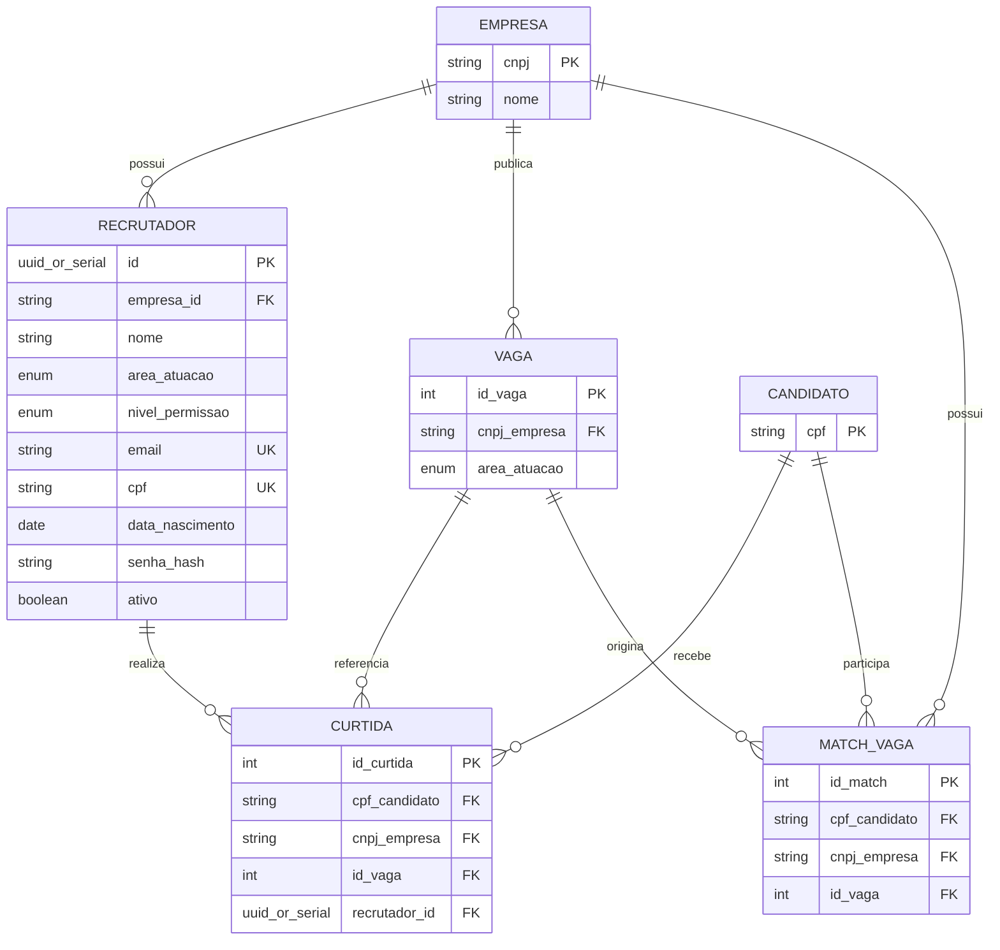

# Especificação: Recrutador

## Contexto e Objetivo

O Linketinder atualmente representa a interação de recrutamento principalmente
por meio do perfil da Empresa. Esta feature introduz o perfil **Recrutador**,
um colaborador cadastrado pelo usuário principal da Empresa para analisar
candidatos e vagas e registrar curtidas em nome da Empresa.

O objetivo é permitir que uma Empresa tenha vários recrutadores, com níveis de
permissão e escopo de atuação controlados, mantendo o match pertencente à
Empresa e registrando qual recrutador realizou cada curtida. A feature deve
ser implementada de forma integrada nas camadas de banco, back-end e
front-end, com API e telas próprias para autenticação e operação do
Recrutador.

O **Princípio do Anonimato** definido em `AGENTS.md` é soberano e se aplica a
esta feature, aos novos contratos e às superfícies existentes que forem
alteradas.

## Escopo

- Criar a entidade Recrutador, vinculada a exatamente uma Empresa.
- Permitir que o usuário principal da Empresa cadastrada crie, edite e inative
  recrutadores da própria Empresa.
- Persistir `nivel_permissao` com os valores `Total` e `Limitado`.
- Autenticar o Recrutador exclusivamente por e-mail e senha.
- Permitir que recrutadores analisem candidatos e registrem curtidas em nome da
  Empresa.
- Permitir múltiplas curtidas de recrutadores da mesma Empresa para o mesmo
  candidato e a mesma vaga, mantendo a autoria de cada curtida.
- Associar o match à Empresa e à vaga, sem duplicar o match por recrutador,
  quando houver interesse recíproco.
- Restringir a visualização de vagas ao escopo de área do Recrutador, salvo
  permissões excepcionais de apoio que sejam explicitamente modeladas.
- Permitir que recrutadores com permissão `Total` criem, editem e excluam
  vagas de sua área.
- Permitir que recrutadores com permissão `Limitado` apenas gerenciem e
  contribuam na análise de perfis e nas curtidas, sem criar, editar ou excluir
  vagas.
- Expor API e telas próprias de Recrutador, com autenticação e autorização
  compatíveis com o escopo acima.
- Corrigir as listagens, endpoints, payloads, consultas, logs e telas
  existentes que violem o anonimato.

## Fora do Escopo

- Vincular um Recrutador a mais de uma Empresa.
- Permitir que o Recrutador altere CNPJ, razão social ou outros dados
  principais da Empresa.
- Permitir que o Recrutador crie, edite ou exclua vagas fora de sua área.
- Permitir operações de vaga para o nível `Limitado`.
- Exibir CPF, data de nascimento ou senha do Recrutador em qualquer contexto.
- Exibir fotos de candidatos antes do match.
- Alterar o modelo de negócio para que o match pertença individualmente a um
  Recrutador.
- Definir recuperação, expiração, bloqueio ou troca de senha, pois essas regras
  não foram aprovadas nesta etapa.
- Adicionar competências próprias ao Recrutador; sua classificação será feita
  por `area_atuacao` predefinida.
- Especificar novos canais de contato além do e-mail do Recrutador liberado
  após o match.

## Regras de Negócio

1. Um Recrutador deve pertencer a uma única Empresa por meio de
   `empresa_id`. Uma Empresa pode possuir zero, um ou vários Recrutadores.
2. O cadastro de Recrutador só pode ser realizado pelo usuário/perfil
   principal de uma Empresa já existente e autenticada.
3. `id` é o identificador primário próprio do Recrutador. `email` e `cpf`
   possuem unicidade global.
4. A Empresa pode editar os dados de seus Recrutadores e inativá-los. A
   exclusão deve ser lógica, preservando registros históricos e autoria de
   curtidas.
5. `area_atuacao` deve usar uma lista predefinida (`Enum`), incluindo as áreas
   aprovadas como exemplo: `TI`, `RH`, `Marketing`, `Vendas` e `Segurança`.
   A lista final deve ser centralizada para manter consistência entre banco,
   back-end e front-end.
6. O Recrutador visualiza prioritariamente candidatos compatíveis com sua
   área/vaga e somente vagas referentes à sua própria área. A autorização deve
   ser aplicada no servidor, não apenas filtrada na interface.
7. Recrutadores com `nivel_permissao = Total` podem criar, editar e excluir
   vagas de sua área. Recrutadores com `nivel_permissao = Limitado` não podem
   executar essas operações.
8. Nenhum Recrutador pode alterar os dados principais da Empresa, incluindo
   CNPJ e razão social.
9. A curtida realizada por um Recrutador é uma curtida da Empresa para fins de
   reciprocidade e match, mas deve armazenar `recrutador_id` para identificar
   o autor.
10. Mais de um Recrutador da mesma Empresa pode curtir o mesmo candidato para a
    mesma vaga. Cada ação deve ser preservada como avaliação/autoria distinta,
    respeitando a unicidade e as regras de persistência aprovadas para uma
    curtida individual.
11. O match continua pertencendo à Empresa e à vaga. Curtidas de múltiplos
    Recrutadores não devem criar matches duplicados para a mesma tupla
    candidato–Empresa–vaga.
12. Uma curtida feita em nome da Empresa é permanente no contexto do match.
    Um Recrutador não pode remover uma curtida feita por outro Recrutador da
    mesma Empresa.
13. Depois do match, todos os Recrutadores da Empresa autorizados para a vaga
    ou área podem visualizar os dados liberados do candidato.
14. O login do Recrutador usa exclusivamente e-mail e senha.
15. O e-mail exige apenas uma validação básica de string contendo `@` e deve
    ser único globalmente.
16. O CPF pode ser informado com máscara no front-end, deve ser normalizado
    para somente números na persistência e terá validação básica de formato,
    sem exigir validação completa dos dígitos verificadores nesta etapa.
17. A data de nascimento deve usar o formato ISO `AAAA-MM-DD` no back-end e
    no banco, e o Recrutador deve ter no mínimo 18 anos.
18. A senha deve ter entre 6 e 8 caracteres, sem exigência obrigatória de
    caracteres especiais, e deve ser persistida usando hash seguro, como
    BCrypt. A senha em texto puro não pode ser persistida, retornada ou
    registrada.

## Modelo de Dados

### Entidade `recrutador`

| Campo | Tipo/regra | Observação |
|---|---|---|
| `id` | PK autoincremento ou UUID | Identificador próprio e único |
| `nome` | texto obrigatório | Nome do Recrutador |
| `area_atuacao` | enum obrigatório | Área predefinida |
| `nivel_permissao` | enum obrigatório | `Total` ou `Limitado` |
| `descricao` | texto | Descrição profissional |
| `email` | texto obrigatório, `UNIQUE` | Login e contato pós-match |
| `cpf` | texto obrigatório, `UNIQUE` | Armazenado somente com números |
| `data_nascimento` | data ISO, obrigatório | Deve corresponder a idade mínima de 18 anos |
| `senha` | texto obrigatório | Hash seguro, nunca texto puro |
| `empresa_id` | FK obrigatória | Referência para uma única `empresa` |
| `ativo` | booleano | Controle de exclusão lógica/inativação |

O campo `ativo` é necessário para representar a exclusão lógica aprovada sem
apagar a autoria histórica das curtidas. O nome exato dos tipos SQL e a escolha
entre UUID e sequência autoincremental devem seguir o padrão adotado no módulo
que implementar a persistência.

### Alterações em entidades existentes

- `curtida` deve receber `recrutador_id` como FK opcional ou obrigatória
  conforme o fluxo legado, preservando a possibilidade de registros antigos
  sem autoria de Recrutador.
- A curtida continua identificando candidato, empresa e vaga. A autoria
  adicional permite várias curtidas de Recrutadores da mesma Empresa na mesma
  tupla.
- `match_vaga` continua representando a reciprocidade por
  `(cpf_candidato, cnpj_empresa, id_vaga)` e continua pertencendo à Empresa.
  Não deve receber uma unicidade que impeça múltiplas curtidas de
  Recrutadores, nem deve gerar um match por autor.
- `empresa` permanece a entidade proprietária de vagas e passa a relacionar-se
  com Recrutadores.
- `vaga` deve possuir ou receber a informação necessária para relacionar sua
  área ao `area_atuacao` do Recrutador e aplicar a autorização de escopo.
  O formato dessa área deve ser único entre os módulos.

### Relacionamentos

- Empresa `1:N` Recrutador.
- Recrutador `N:1` Empresa.
- Empresa `1:N` Vaga.
- Recrutador `1:N` Curtida, atuando em nome da Empresa.
- Candidato `1:N` Curtida.
- Vaga `1:N` Curtida.
- Candidato, Empresa e Vaga formam a tupla do Match.
- Uma Empresa pode ter vários Recrutadores autorizados para a mesma área/vaga.

O diagrama expressa obrigatoriamente que cada Recrutador possui exatamente uma
Empresa (`empresa_id` não nulo), enquanto uma Empresa pode possuir vários
Recrutadores.

## Anonimato

Esta seção é restrita e inquebrável. Nenhum endpoint, DTO, consulta, log,
payload, tela, exportação ou dado derivado pode contornar estas regras.

### Recrutador visualizando candidato

**Antes do match**, o Recrutador pode visualizar somente:

- competências;
- descrição profissional;
- Estado e Cidade;
- afinidade profissional necessária para a decisão, sem criar identificação
  indireta.

Antes do match, devem permanecer ocultos:

- nome e qualquer identificador equivalente;
- CPF;
- e-mail e qualquer contato;
- idade ou faixa etária;
- data de nascimento;
- foto;
- CEP/endereço detalhado;
- qualquer outro dado identificável ou sensível.

**Depois do match**, o Recrutador autorizado pela Empresa e pela área/vaga pode
visualizar os dados do candidato liberados pelo produto. A liberação deve
continuar limitada à tupla exata candidato–Empresa–vaga que gerou o match.

### Candidato visualizando Recrutador

Antes do match, o candidato não deve receber identidade, contato ou dados
pessoais do Recrutador como consequência de uma análise ou curtida.

**Depois do match**, além dos dados da Empresa (nome, descrição, etc.) já previstos no sistema, o candidato passa a visualizar o Recrutador como seu ponto de contato direto:

- nome do Recrutador;
- área de atuação do Recrutador;
- e-mail do Recrutador para contato direto.

Em qualquer momento, inclusive depois do match, nunca podem ser exibidos,
retornados, registrados ou exportados:

- CPF do Recrutador;
- data de nascimento do Recrutador;
- senha ou hash de senha do Recrutador.

### Superfícies existentes

O anonimato deve corrigir também as listagens administrativas, perfis
completos, endpoints e respostas legadas de candidatos, empresas, vagas e
matches que hoje possam expor e-mail, CPF, CNPJ, nome ou outros dados antes da
autorização correta. A implementação da feature não pode ampliar essas
exposições.

## Decisões tomadas

As decisões abaixo foram discutidas e aprovadas com o Tutor:

- Recrutador pertence a uma única Empresa; Empresa pode ter vários
  Recrutadores.
- Usuário/perfil principal da Empresa cadastra, edita e inativa Recrutadores.
- Empresa precisa existir previamente no banco.
- Recrutador possui ID próprio; CPF e e-mail são chaves únicas globais.
- Curtida do Recrutador conta como curtida da Empresa.
- Match pertence à Empresa, mas cada curtida registra o Recrutador autor.
- Múltiplos Recrutadores podem curtir o mesmo candidato para a mesma vaga.
- Após o match, Recrutadores autorizados da Empresa podem acessar os dados
  liberados.
- Curtida feita em nome da Empresa não pode ser removida por outro
  Recrutador.
- Área de atuação é uma lista predefinida.
- Visibilidade de vagas é limitada à área do Recrutador, com exceções de apoio
  somente se houver permissão explicitamente implementada.
- Permissão `Total` permite criar, editar e excluir vagas da área; `Limitado`
  permite apenas analisar perfis e curtir.
- Recrutador não altera dados principais da Empresa.
- A feature terá API e telas próprias.
- Antes do match, candidato é representado apenas por competências, descrição
  profissional e Estado/Cidade; nome, idade e foto ficam ocultos.
- Depois do match, candidato vê os dados liberados da Empresa e, adicionalmente, o nome, área e e-mail corporativo do Recrutador.
- CPF, data de nascimento e senha do Recrutador nunca são exibidos.
- Anonimato também corrige a dívida técnica de endpoints e listagens antigas.
- E-mail aceita validação básica contendo `@` e é único globalmente.
- CPF aceita máscara no front-end, é normalizado e recebe validação básica de
  formato.
- Data de nascimento usa ISO `AAAA-MM-DD` e exige idade mínima de 18 anos.
- Senha tem entre 6 e 8 caracteres e é armazenada com hash seguro, como
  BCrypt.
- Login ocorre somente por e-mail e senha.
- A implementação abrangerá banco, back-end e front-end.

## Contratos e Integrações

- A API deverá oferecer fluxo próprio para cadastro, edição, inativação e
  autenticação de Recrutadores, sem reutilizar autorização de Empresa de forma
  implícita.
- Toda operação deverá derivar a Empresa do Recrutador autenticado e validar
  `ativo`, `nivel_permissao` e `area_atuacao` no servidor.
- O cadastro deve exigir uma Empresa existente e impedir associação a outra
  Empresa.
- Respostas de Recrutador devem excluir `senha`, hash, CPF e
  `data_nascimento`, inclusive para o próprio cliente após autenticação,
  quando não forem estritamente necessários ao fluxo.
- Operações de curtida devem carregar a autoria (`recrutador_id`) e a Empresa
  efetiva, sem permitir que o cliente escolha arbitrariamente uma Empresa.
- A criação de Match deve reutilizar a reciprocidade por candidato, Empresa e
  vaga, preservando uma única tupla de Match mesmo com várias curtidas de
  Recrutadores.
- Consultas de candidatos e vagas devem aplicar anonimato e escopo de área
  antes de serializar a resposta.
- O banco PostgreSQL deve receber migração incremental em
  `BancoDeDados/`, preservando dados legados e a integridade das FKs.
- O front-end deve ter modelos, telas e controle de sessão próprios para
  Recrutador; não deve confiar apenas em filtros visuais para autorização.
- As validações devem ser cobertas por testes do back-end e, quando aplicável,
  por validações do front-end e testes de integração com PostgreSQL.

## Critérios de Aceite

- [ ] Dado uma Empresa existente e autenticada como perfil principal, quando
      cadastrar um Recrutador válido, então o registro será criado com
      `empresa_id`, `area_atuacao`, `nivel_permissao` e senha protegida por
      hash.
- [ ] Dado uma Empresa inexistente, quando tentar cadastrar um Recrutador,
      então a operação será rejeitada sem registro órfão.
- [ ] Dado um Recrutador já vinculado a uma Empresa, quando tentar associá-lo
      a outra Empresa, então a operação será rejeitada.
- [ ] Dado e-mail ou CPF já usado por qualquer cadastro de Recrutador, quando
      cadastrar outro Recrutador, então a operação será rejeitada por
      unicidade global.
- [ ] Dado um Recrutador inativado, quando tentar autenticar ou operar, então
      o acesso será recusado e seu histórico de curtidas será preservado.
- [ ] Dado um Recrutador `Limitado`, quando tentar criar, editar ou excluir
      vaga, então a operação será recusada no back-end.
- [ ] Dado um Recrutador `Total`, quando operar em vaga de sua área, então
      poderá criar, editar ou excluir a vaga conforme as regras da Empresa.
- [ ] Dado um Recrutador, quando listar vagas, então não receberá vagas de
      outras áreas, salvo uma exceção de apoio explicitamente autorizada.
- [ ] Dado dois Recrutadores da mesma Empresa, quando ambos curtirem o mesmo
      candidato para a mesma vaga, então as duas autorias serão preservadas e
      não haverá duplicação do Match da Empresa.
- [ ] Dado uma curtida do Recrutador, quando houver curtida recíproca do
      candidato para a mesma vaga, então será criado Match para a tupla
      candidato–Empresa–vaga.
- [ ] Dado uma curtida feita por outro Recrutador da Empresa, quando um
      Recrutador tentar removê-la, então a remoção será recusada e a curtida
      permanecerá registrada.
- [ ] Dado um candidato sem Match, quando um Recrutador consultar seu perfil,
      então a resposta conterá apenas competências, descrição profissional,
      Estado/Cidade e afinidade permitida, sem nome, idade, foto, CPF,
      e-mail, data de nascimento ou endereço detalhado.
- [ ] Dado um Match válido, quando um Recrutador autorizado consultar o
      candidato, então receberá somente os dados liberados para aquela tupla.
- [ ] Dado um candidato com Match, quando consultar os dados do Recrutador,
      então verá nome, área de atuação e e-mail, mas nunca CPF, data de
      nascimento, senha ou hash.
- [ ] Dado qualquer endpoint, payload, log, listagem ou tela existente
      relacionada a candidatos, empresas, vagas e matches, quando for
      acessível antes do Match, então não exporá dados identificáveis da outra
      parte.
- [ ] Dado uma senha válida de 6 a 8 caracteres, quando cadastrada, então
      somente o hash seguro será persistido e o valor original não será
      retornado.
- [ ] Dado data de nascimento anterior ao mínimo de 18 anos, formato ISO
      inválido, CPF fora do formato básico ou e-mail sem `@`, quando enviado,
      então o cadastro será rejeitado com erro explícito.
- [ ] Dado o build e as suítes aplicáveis dos módulos alterados, quando
      executados, então passarão sem falhas novas e cobrirão autorização,
      anonimato, curtidas múltiplas, match e validações.

## Impacto no que já existe

- **Banco de dados:** criar a tabela `recrutador`, seus enums ou constraints,
  FKs, unicidades e controle de inativação; adicionar autoria à tabela
  `curtida`; relacionar área da vaga quando necessário; preservar a
  unicidade do match por candidato–Empresa–vaga e dados legados.
- **Back-end:** adicionar modelos, DAOs, serviços de validação/autorização,
  autenticação, controllers, servlets e testes para Recrutador; adaptar
  `CurtidaDAO`, `MatchDAO`, `GerenciadorDePerfisService` e contratos
  relacionados para registrar autoria sem quebrar a regra de match da Empresa.
- **Anonimato:** revisar `CandidatoServlet`, `EmpresaServlet`, `VagaServlet`,
  `MatchServlet`, DAOs e serialização de respostas; corrigir especialmente
  listagens administrativas, perfis completos e curtidas pendentes que possam
  revelar identidade antes do Match.
- **Front-end:** adicionar interfaces, sessão, login, cadastro, gestão de
  recrutadores, telas próprias, escopo por área, níveis de permissão e
  visualizações anonimizadas; adaptar chamadas existentes para não confiar em
  dados sensíveis recebidos do servidor.
- **Microsserviço de cadastro:** avaliar a integração com o fluxo separado de
  `CadastroMicroService`; qualquer cadastro de Recrutador deve respeitar as
  mesmas unicidades, validações e proteção de senha, sem duplicar regras
  incompatíveis.
- **Testes:** ampliar os testes Groovy por camada e o build TypeScript para
  cobrir vínculo único, permissões, inativação, hash, área, múltiplas curtidas,
  match, anonimato antes/depois e regressão dos endpoints existentes.
- **Documentação e migrações:** adicionar scripts incrementais em
  `BancoDeDados/`, atualizar a documentação diretamente relacionada e registrar
  a implementação no `CHANGELOG.md`.
- **Riscos:** o banco atual não possui Recrutador, autenticação persistente nem
  área de vaga documentada; a compatibilidade com curtidas legadas sem autoria
  deve ser definida na migração sem permitir exposição de dados ou perda de
  histórico.
